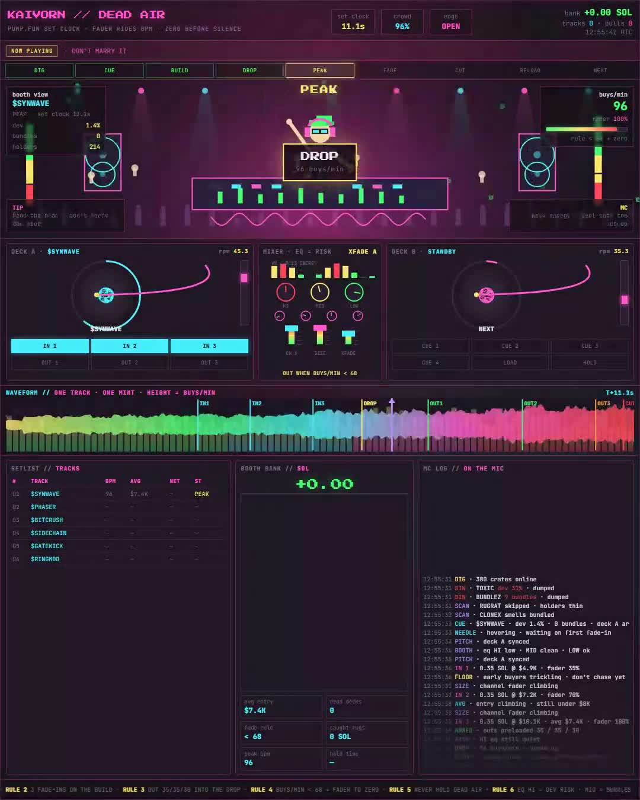
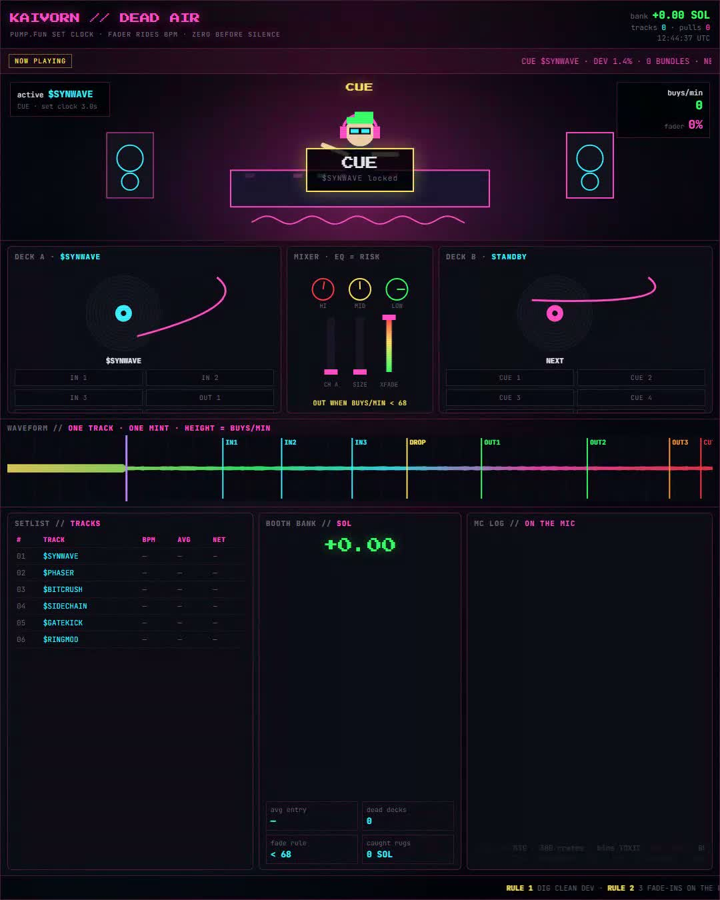
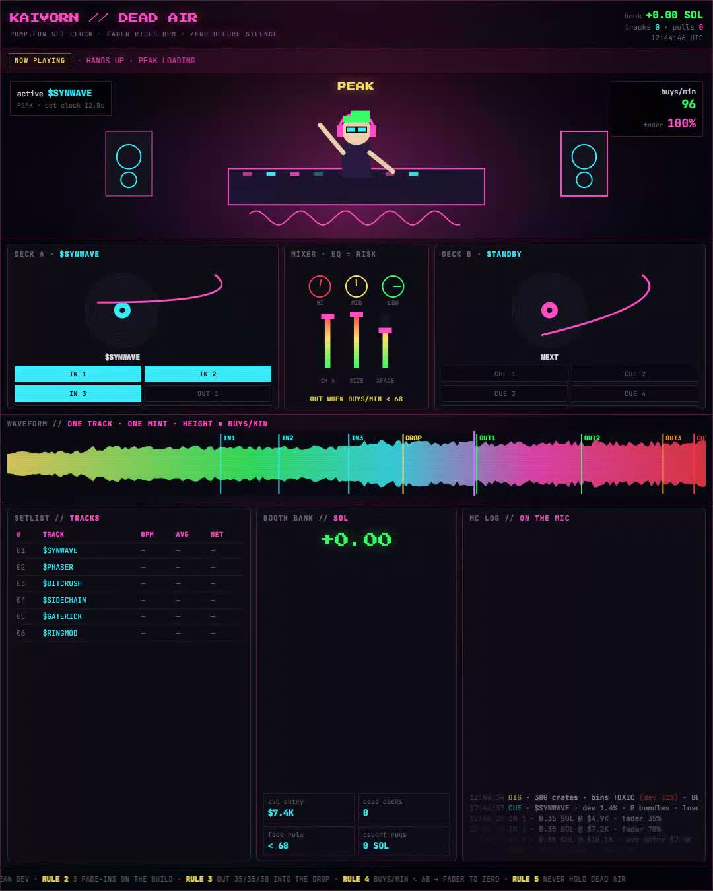
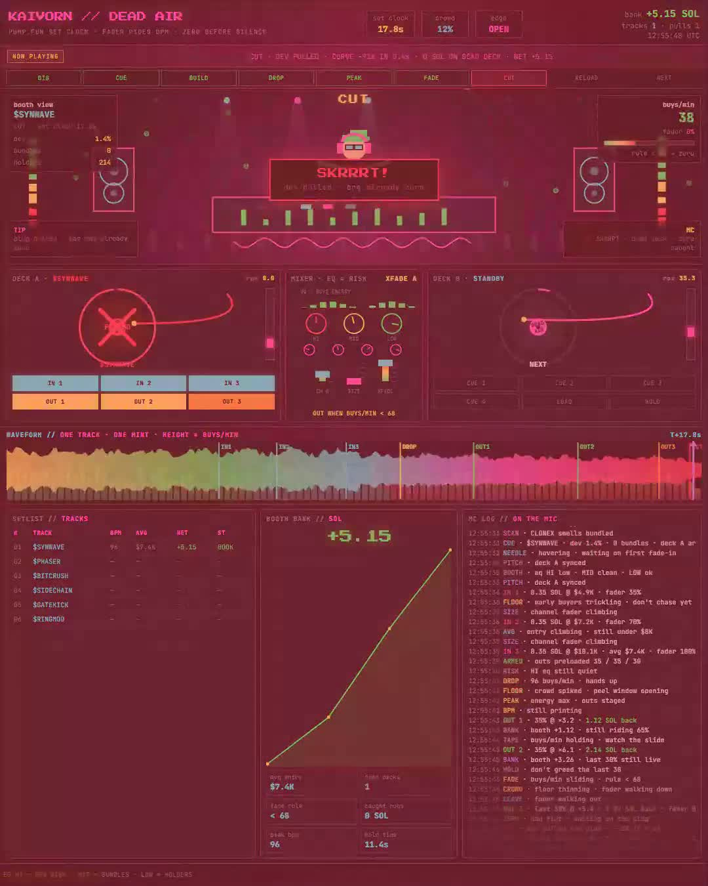

# DEAD AIR

<p align="center">
  <a href="https://github.com/kaivornxbt"></a>
  <a href="https://pump.fun"></a>
  <a href="./index.html"></a>
  <a href="https://x.com/kaivornxbt/status/2111079589631943145"></a>
</p>

<p align="center">
  <b>Booth that mixes pump.fun.</b><br/>
  Buys per minute is the BPM. When the BPM dies, the track is over.<br/>
  Fader to zero before silence. Dev pulls later. Bag already flat.
</p>

```
DIG → CUE → BUILD → DROP → PEAK → FADE → CUT → RELOAD → NEXT
```

<p align="center">
  
</p>

<p align="center">
  <a href="./demo.mp4"><b>▶ Watch the 28s set (demo.mp4)</b></a>
  &nbsp;·&nbsp;
  <a href="./index.html"><b>Open live terminal</b></a>
</p>

---

## Why

| most bots | DEAD AIR |
|-----------|----------|
| all in on one click | 3 fade-ins on the build |
| all out on one panic | outs armed before entry (35 / 35 / 30) |
| still holding when the plug pulls | fader hits 0 when buys/min &lt; 68 |
| dancing on dead air | already digging the next crate |

---

## Gallery

<p align="center">
  
  
  
</p>

| DIG → CUE | DROP → PEAK | CUT |
|-----------|-------------|-----|
| bin fat-dev / bundles, load clean mint | 96 buys/min, peel into the cheer | plug pulled, **0 SOL** on dead deck |

<p align="center">
  
</p>

---

## Rules on the board

1. **DIG clean** — fat dev / bundles go in the bin  
2. **3 fade-ins** on the build — never one-click ape  
3. **OUT 35 / 35 / 30** into the drop  
4. **buys/min &lt; 68 → fader to zero**  
5. **never hold dead air**  
6. **EQ = risk** — HI dev · MID bundles · LOW holders  

---

## How a set runs

One mint = one track. Club cam, both decks, mixer, waveform, setlist and bank all read **one set clock**.

| # | Phase | What the booth does |
|---|-------|---------------------|
| 1 | **DIG** | 380 crates · dump TOXIC (dev 31%) · dump BUNDLEZ (9 bundles) |
| 2 | **CUE** | Lock clean mint · dev 1.4% · 0 bundles · needle ready |
| 3 | **BUILD** | 3×0.35 SOL @ $4.9K / $7.2K / $10.1K · avg **$7.4K** · fader **100%** |
| 4 | **DROP** | **96 buys/min** · hands up · outs hot |
| 5 | **PEAK** | OUT 1 · 35% @ ×3.2 → **+1.12 SOL** |
| 6 | **PEAK** | OUT 2 · 35% @ ×6.1 → **+2.14 SOL** |
| 7 | **FADE** | 96 → 66 buys/min · rule &lt; 68 · OUT 3 · 30% @ ×5.4 → **+1.89 SOL** · fader **0%** |
| 8 | **CUT** | Dev pulls 0.8s later · −91% · **0 SOL caught** |
| 9 | **RELOAD** | Next record already on deck B |

**Net one track: +5.15 SOL · 0 SOL in dead air**

Illustrative round. Not live trading telemetry.

---

## What's on the desk

| Module | Job |
|--------|-----|
| **Club cam** | DJ booth · crowd energy · tip + MC lines |
| **Deck A / B** | Live mint vs next cue · vinyl · rpm · hot cues |
| **Mixer** | EQ = risk · size fader · crossfader |
| **Waveform** | Height = buys/min · IN / DROP / OUT / CUT markers |
| **Setlist** | Tracks · BPM · avg · net · status |
| **Booth bank** | SOL curve · peak bpm · hold time · caught rugs |
| **MC log** | Real-time booth chatter |

Alone each module is gear. Together it's a set that never plays into dead air.

---

## Demo setlist (example)

| # | Track | Peak BPM | Avg | Net | Status |
|---|-------|----------|-----|-----|--------|
| 01 | $SYNWAVE | 96 | $7.4K | +5.15 | BOOK |
| 02 | $PHASER | 91 | $6.9K | +5.15 | BOOK |
| 03 | $BITCRUSH | 88 | $8.1K | +5.15 | BOOK |
| 04 | $SIDECHAIN | 102 | $7.0K | +5.15 | BOOK |
| 05 | $GATEKICK | 94 | $7.6K | +5.15 | BOOK |
| 06 | $RINGMOD | 97 | $7.3K | +5.15 | BOOK |

6 tracks · 6 dev pulls · **0 SOL caught in any of them**

---

## Run it

```bash
# clone
git clone https://github.com/kaivornxbt/deadair.git
cd deadair

# open the booth (Chrome)
start index.html   # Windows
# open index.html  # macOS
```

| | |
|--|--|
| Frame | **1080 × 1350** |
| Loop | ~**28s** one full set |
| Stack | HTML · Canvas · CSS · no backend |
| Video | [`demo.mp4`](./demo.mp4) |

No install. No server. Just the booth.

---

## Files

```
deadair/
├── index.html      # live terminal (open in Chrome)
├── demo.mp4        # 28s recorded set
├── preview.jpg     # DROP / PEAK still
├── preview-cut.jpg # CUT / fader zero still
├── shot-dig.jpg    # early dig / cue still
├── shot-peak.jpg   # peak still
└── README.md
```

---

## Links

- X post: https://x.com/kaivornxbt/status/2111079589631943145  
- GitHub: https://github.com/kaivornxbt/deadair  
- Profile: https://github.com/kaivornxbt  

---

<p align="center">
  <i>most bots are still dancing when the plug gets pulled.<br/>DEAD AIR is already digging for the next record.</i>
</p>
